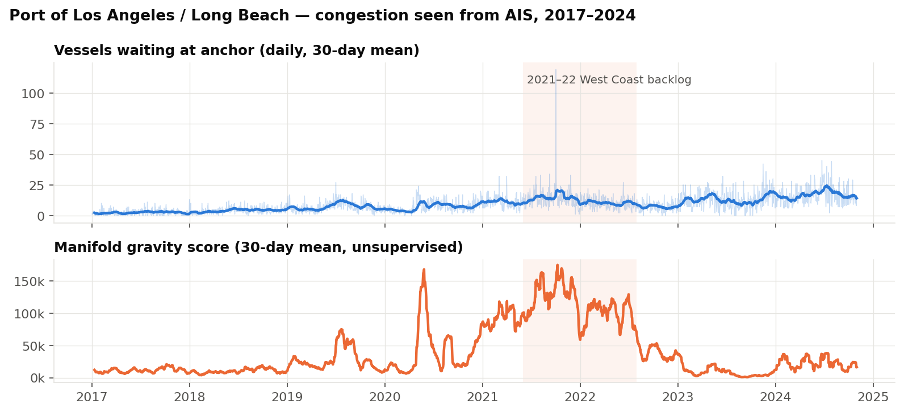
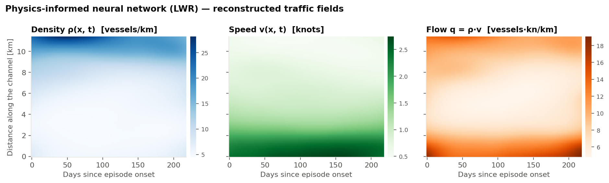
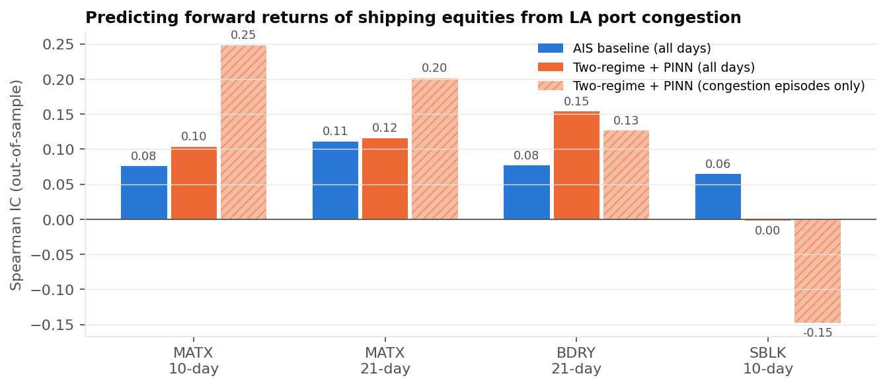

# Maritime Nowcasting — from ship tracking data to freight-market signals

[](https://github.com/louisrodembourg/Nowcasting/actions/workflows/tests.yml)


**Can raw vessel positions tell us how congested a port is, how long the congestion will last, and what it means for shipping stocks?**

This academic research project (March–June 2026) builds an end-to-end pipeline from **AIS data** (the transponder signal every large ship broadcasts) to an interpretable market alert:

> *"Congestion at port X should take N days to clear and move asset Z by Y%."*

## Why

Supply-chain shocks show up **physically** before they show up in prices: ships pile up at anchor during the 2021 US West Coast backlog, Hurricane Harvey or the Red Sea crisis. AIS data captures that physical layer in near real time and is publicly available. The question is whether a robust, physically grounded congestion signal carries information that markets have not priced in yet.

The main case study is the **Port of Los Angeles / Long Beach, 2017–2024** (~2,800 days of NOAA AIS data). Houston (Hurricane Harvey) and the Suez Canal served as secondary test cases.



## Approach

| Phase | Method | Why this choice |
|---|---|---|
| **1. Ingestion** | DuckDB/Polars cleaning, kinematic filtering, daily **HDBSCAN** on stationary ships | Separates berthed ships from ships waiting at anchor. Copes with very uneven densities. |
| **2. Disruption score** | KNN graph + **Laplace–Beltrami spectrum** over port zones → daily *gravity score* | Unsupervised. Learned on a calm baseline, then frozen to score crises. |
| **3. Physics** | **Physics-informed neural network** constrained by the LWR traffic-flow law ∂ρ/∂t + ∂(ρv)/∂x = 0 | Fills sparse, noisy AIS coverage consistently with mass conservation. Yields density and speed fields and a time-to-clear. |
| **4. Markets** | Walk-forward Ridge / XGBoost, a two-regime model (normal days vs. congestion episodes), **SHAP** | Strictly out-of-sample on time series. Every prediction can be explained. |

The PINN uses a Courant-number rescaling of the PDE residual, optional Fourier features and a curriculum warm-up of the physics loss.



## Results



- **The AIS signal is predictive.** Port congestion forecasts 21-day returns of shipping equities out-of-sample (Spearman IC 0.08–0.12 for MATX, BDRY and SBLK, all p < 0.05).
- **Physics helps where it should.** For **Matson (MATX)**, a US–Pacific container carrier, the two-regime PINN model lifts the 10-day IC from 0.076 to 0.103 (+37%). On congestion-episode days alone, the IC reaches **0.25** (p < 0.001), with 60% directional accuracy at 21 days.
- **Negative control.** The same signal *hurts* the dry-bulk carrier SBLK (episode IC −0.15). This is consistent with a container-specific transmission channel rather than a generic macro factor.
- **Limitations.** Each PINN is fitted offline on its 90-day episode window, so there is some look-ahead inside episodes, and 2021 is confounded by COVID demand. Episode ICs are therefore upper bounds.

## Quickstart

```bash
pip install -r requirements.txt     # Python 3.11+; PyTorch uses MPS on Apple Silicon, CUDA or CPU otherwise
pytest                              # unit tests: LWR physics, AIS filtering, PINN summaries, XGBoost+SHAP

# Demo without any data: time-to-clear regression + SHAP plots on synthetic episodes
python src/correlation/ttc_xgb_shap.py --synthetic --output-dir outputs/demo
```

Full pipeline (run from the repository root; AIS data is downloaded from public NOAA archives):

```bash
python scripts/run_phase1.py --location la --start 2019-01-01 --end 2019-12-31        # ① AIS + HDBSCAN + features
python src/manifold/manifold_pipeline.py --both --location la \
    --baseline-start 2017-01-01 --baseline-end 2017-12-31 --start 2017-01-01 --end 2024-12-31   # ② gravity score
python src/pinns/pinn_pipeline.py --both --location la --warmup-epochs 500           # ③ PINN + time-to-clear
python src/correlation/two_regime_model.py                                           # ④ market models
python scripts/make_readme_figures.py                                                # figures above
```

## Repository

```
src/
  ingestion/     NOAA AIS download, kinematic filter, trajectory interpolation
  clustering/    daily HDBSCAN, 13 daily features, cluster maps
  manifold/      gravity score (spectral manifold) + PCA/NMF baselines
  pinns/         LWR physics-informed network, episodic training and inference
  correlation/   financial alignment, walk-forward models, two-regime model, SHAP
  index/         freight / equity index download and plots
scripts/         end-to-end runners and README figures
tests/           pytest suite (runs in CI)
report/          LaTeX report section (French)
suez_version/    exploratory Suez Canal variant
```

Module-level details are in [ARCHITECTURE.md](ARCHITECTURE.md).

**Stack:** Python · DuckDB · Polars · PyTorch · HDBSCAN · scikit-learn · XGBoost · SHAP · Plotly · Folium

## Authors

[Hadrien Gleyze](https://github.com/hadrienglz) & [Louis Rodembourg](https://github.com/louisrodembourg)
