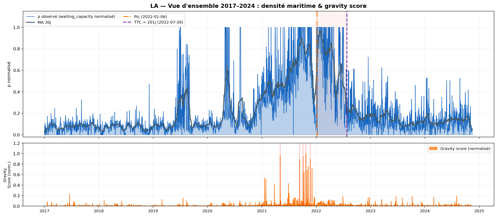

# Maritime Nowcasting — from ship tracking data to freight-market signals

> Can we measure port congestion from raw vessel positions, predict how long it will take to clear, and turn that into a tradable signal on shipping stocks?

Academic research project (March–June 2026). We built an end-to-end pipeline that goes from **AIS data** (satellite/terrestrial tracking of ships) to an interpretable alert of the form:

> *"Congestion at port X should take N days to clear and move index Z by Y%."*

## Context

Supply-chain shocks, such as the 2021 US West Coast backlog, Hurricane Harvey in 2017 and the 2023–24 Red Sea crisis, first show up **physically**, as ships piling up at anchor, and only later in freight rates and shipping equities. AIS data captures the physical side in near real time and is publicly available. The goal is to measure that disruption early and in a robust way, and to check whether it carries information that markets have not yet priced in.

Main case study: **Port of Los Angeles / Long Beach, 2017–2024** (~2,100 days of AIS data). The Houston Ship Channel (Hurricane Harvey) and the Suez Canal were used as secondary test cases.

## Approach

```
 NOAA AIS (daily, ~100k msgs/port)
        │
 ① Ingestion & clustering ── DuckDB/Polars cleaning, kinematic filtering,
        │                    HDBSCAN on stationary ships → docked vs. waiting
        ▼
 ② Manifold "gravity score" ── KNN graph + Laplace–Beltrami spectrum over
        │                      port zones → one daily disruption score
        ▼
 ③ Physics-informed NN ── PINN constrained by the LWR traffic-flow PDE
        │                 ∂ρ/∂t + ∂(ρv)/∂x = 0  → density field ρ(x,t), time-to-clear
        ▼
 ④ Market link ── lag-scan, walk-forward Ridge / XGBoost, two-regime model,
                  SHAP explanations → returns of MATX, BDRY, SBLK
```

| Phase | Why this method |
|---|---|
| **HDBSCAN** | Handles very uneven densities (berths vs. open anchorage) and gives a continuous membership score instead of hard labels. |
| **Spectral manifold** | Compresses dozens of zone-level counts into a stable, unsupervised anomaly score, learned on a calm reference period. |
| **PINN + LWR** | AIS is sparse and noisy; the conservation law fills the gaps in a physically consistent way and can extrapolate the clearing dynamics. Training adds a Courant-number rescaling, optional Fourier features and curriculum warm-up. |
| **Walk-forward models + SHAP** | Strictly out-of-sample evaluation on time series, with explainable drivers. |

## Key results



- The **gravity score** isolates the 2021–22 LA/Long Beach backlog with no supervision. The PINN-derived time-to-clear for the main episode is ~200 days (peak Jan 2022 → back to normal Jul 2022).
- **The baseline AIS signal is predictive.** It is significant (p < 0.01) on MATX, BDRY and SBLK at a 21-day horizon, with an out-of-sample Spearman IC of 0.08–0.16.
- **The PINN adds value where it should.** During congestion episodes, the PINN density predicts 10-day returns of **Matson (MATX)**, a US–Pacific container carrier, with **IC = 0.25** (p < 0.001) and 60% directional accuracy at 21 days. Moving from the raw gravity score to the two-regime PINN model raises the IC from 0.07 to 0.25.
- **Negative control.** The same signal *hurts* dry-bulk (SBLK) predictions. This is consistent with a container-specific mechanism rather than a spurious macro factor.
- **Limitations, stated honestly.** The PINN is trained offline on each 90-day window, which creates a look-ahead inside the episode, and 2021 is confounded by COVID. Episode ICs should therefore be read as upper bounds.


## Repository structure

```
src/
  ingestion/     AIS download (NOAA Marine Cadastre), kinematic filter, trajectories
  clustering/    daily HDBSCAN, 13 daily features, cluster maps
  manifold/      gravity score (spectral manifold), PCA/NMF baselines
  pinns/         LWR PINN model + episodic training / inference pipeline
  correlation/   financial alignment, TTC XGBoost+SHAP, return prediction, two-regime model
  index/         freight / equity index download & plots
scripts/         end-to-end runners (phase 1, per-episode PINN, phase 4 XGBoost)
suez_version/    exploratory Suez Canal variant (Global Fishing Watch data)
report/          LaTeX report sections (French)
notebooks/       exploration only
```

See [ARCHITECTURE.md](ARCHITECTURE.md) for module-level details.

## Quickstart

```bash
pip install -r requirements.txt          # Python 3.11+, PyTorch uses MPS on Apple Silicon

# ① Download AIS + daily HDBSCAN + features
python scripts/run_phase1.py --location la --start 2019-01-01 --end 2019-12-31

# ② Gravity score (learn topology on a calm baseline, then score)
python src/manifold/manifold_pipeline.py --both --location la \
    --baseline-start 2017-01-01 --baseline-end 2017-12-31 --start 2017-01-01 --end 2024-12-31

# ③ PINN: detect episodes, train, infer the density field and time-to-clear
python src/pinns/pinn_pipeline.py --both --location la --warmup-epochs 500

# ④ Market link
python src/correlation/predict_returns.py          # baseline walk-forward models
python src/correlation/two_regime_model.py         # baseline vs. PINN-augmented regimes
python scripts/run_phase4_xgb.py                   # TTC regression + SHAP
```

Run all commands from the repository root. Data (`data/`) and outputs (`outputs/`) are not versioned. Phase 1 recreates the data from public NOAA archives.

## Tech stack

Python · DuckDB · Polars · PyTorch (MPS) · HDBSCAN · scikit-learn · XGBoost · SHAP · Plotly · Folium

## Authors

[Hadrien](https://github.com/hadrienglz) & [Louis Rodembourg](https://github.com/louisrodembourg)
